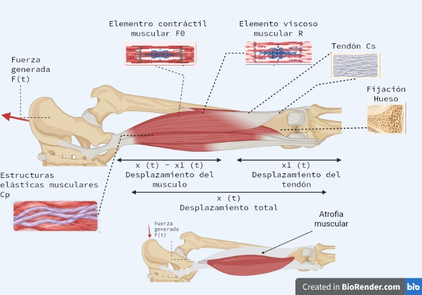
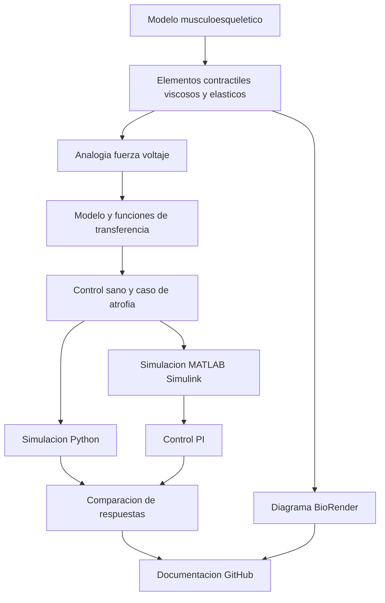

[](https://matlab.mathworks.com/open/github/v1?repo=l23212178-sys/MSFP3)

# Práctica 5.5 — Modelado y control del sistema musculoesquelético

Repositorio académico de **Modelado de Sistemas Fisiológicos (IBF-1020)**, Ingeniería Biomédica, Tecnológico Nacional de México / Instituto Tecnológico de Tijuana. Se analiza un modelo viscoelástico musculoesquelético mediante analogía fuerza–voltaje y se compara una condición de referencia (**control**, individuo sano) con una condición simulada de **atrofia muscular** (**caso**). Se estudia una estrategia de control PI para aproximar la respuesta del caso a la referencia mediante simulación *in silico*.

**Docente:** Dr. Paul Antonio Valle Trujillo  
**Correo:** paul.valle@tectijuana.edu.mx  
**Estudiante:** Osmar Ediel Armenta Medina  
**Número de control:** 23212178  
**Correo:** l23212178@tectijuana.edu.mx  
**Institución:** Tecnológico Nacional de México / Instituto Tecnológico de Tijuana  
**Departamento:** Ingeniería Eléctrica y Electrónica  
**Asignatura:** Modelado de Sistemas Fisiológicos  
**Repositorio:** https://github.com/l23212178-sys/MSFP3

---

## Contenido

1. [Resumen](#resumen)
2. [Competencia y objetivos](#competencia-y-objetivos)
3. [Modelo físico y diagrama biológico](#modelo-físico-y-diagrama-biológico)
4. [Analogía electromecánica](#analogía-electromecánica)
5. [Parámetros](#parámetros)
6. [Formulación matemática y función de transferencia](#formulación-matemática-y-función-de-transferencia)
7. [Análisis de estabilidad y error](#análisis-de-estabilidad-y-error)
8. [Simulación en MATLAB y Simulink](#simulación-en-matlab-y-simulink)
9. [Controlador PI](#controlador-pi)
10. [Implementación en Python](#implementación-en-python)
11. [Resultados y discusión](#resultados-y-discusión)
12. [Verificación cruzada](#verificación-cruzada)
13. [Flujo de trabajo](#flujo-de-trabajo)
14. [Estructura y requisitos](#estructura-y-requisitos)
15. [Conclusiones](#conclusiones)
16. [Referencias](#referencias)

---

## Resumen

Se representa el comportamiento mecánico del músculo y del tendón mediante un elemento contráctil, un amortiguador viscoso y dos elementos elásticos. La práctica utiliza una analogía electromecánica para estudiar cómo el cambio de resistencia equivalente modifica la respuesta dinámica. Se consideran dos modelos: el control con resistencia de 100 Ω y el caso de atrofia muscular con resistencia de 10 kΩ. La comparación se realiza ante un pulso unitario aplicado entre 1 y 2 s, denominado «impulso unitario» en el cuaderno de la práctica. Posteriormente se implementa un controlador proporcional-integral (PI) y se comparan las respuestas calculadas en MATLAB/Simulink y Python.

**Palabras clave:** sistema musculoesquelético; atrofia muscular; analogía fuerza–voltaje; viscoelasticidad; función de transferencia; control PI; MATLAB; Simulink; Simscape Electrical; Python; simulación *in silico*.

## Competencia y objetivos

**Competencia:** modelar un sistema fisiológico a través de ecuaciones diferenciales, analogías físicas y funciones de transferencia; evaluar su comportamiento y diseñar un sistema de control clásico.

**Objetivo general:** comparar la respuesta de un sistema musculoesquelético sano con un caso simulado de atrofia muscular y evaluar la reducción de la diferencia mediante un controlador PI.

**Objetivos específicos:** identificar los componentes del modelo; establecer su analogía eléctrica; formular una función de transferencia; comparar los parámetros control/caso; simular la respuesta a un pulso; implementar el controlador y contrastar los resultados en MATLAB y Python.

## Modelo físico y diagrama biológico



*Figura 1. Diagrama elaborado en BioRender: elemento contráctil, componente viscoso, estructuras elásticas, tendón, fijación ósea y representación del caso de atrofia muscular.*

| Elemento | Significado en el modelo |
|---|---|
| $F_0(t)$ | Fuerza desarrollada por el elemento contráctil |
| $F(t)$ | Fuerza transmitida por el sistema |
| $R$ | Amortiguamiento viscoso |
| $C_p$ | Compliancia de estructuras elásticas en paralelo |
| $C_s$ | Compliancia de la estructura elástica en serie, asociada al tendón |
| $x(t)$ | Desplazamiento total |
| $x_1(t)$ | Desplazamiento de la rama elástica en serie |
| $x(t)-x_1(t)$ | Deformación correspondiente al elemento viscoso |

La fuerza activa se relaciona con la fuerza transmitida mediante $F_0(t)=\alpha F(t)$, con $0<\alpha<1$. El diagrama es una interpretación anatómica de un modelo simplificado, no una representación de toda la fisiología muscular.

## Analogía electromecánica

| Sistema mecánico | Equivalente eléctrico |
|---|---|
| Fuerza $F(t)$ | Voltaje $V(t)$ |
| Velocidad $\dot x(t)$ | Corriente $I(t)$ |
| Desplazamiento $x(t)$ | Carga $q(t)$ |
| Amortiguador viscoso | Resistencia $R$ |
| Compliancia elástica | Capacitancia $C$ |
| Masa (si existe) | Inductancia $L$ |

En la analogía fuerza–voltaje, la conexión eléctrica no necesariamente conserva la topología de las ramas mecánicas. Se deben comprobar las conexiones y los nodos de referencia al interpretar el archivo `sistema.slx`.

## Parámetros

| Parámetro | Control (sano) | Caso (atrofia simulada) |
|---|---:|---:|
| Entrada $F(t)$ | 1 V | 1 V |
| $\alpha$ | 0.25 | 0.25 |
| $C_s$ | 10 µF | 10 µF |
| $C_p$ | 100 µF | 100 µF |
| $R$ | 100 Ω | 10 kΩ |

Los valores corresponden a la emulación eléctrica y no representan mediciones clínicas. La modificación del caso consiste en incrementar $R$ manteniendo las demás constantes.

## Formulación matemática y función de transferencia

Para el modelo eléctrico **implementado en `practica.py`**, la función de transferencia utilizada es

$$
G(s)=\frac{R C_s s+(1-\alpha)}{R(C_p+C_s)s+1}.
$$

Con $\alpha=0.25$, $C_p=100\,\mu\mathrm F$ y $C_s=10\,\mu\mathrm F$:

**Control (individuo sano):**

$$
G_{control}(s)=\frac{0.001s+0.75}{0.011s+1}.
$$

**Caso (atrofia simulada):**

$$
G_{caso}(s)=\frac{0.1s+0.75}{1.1s+1}.
$$

Estas expresiones reproducen exactamente los coeficientes del código Python adjunto. La equivalencia con el modelo mecánico completo debe verificarse mediante las ecuaciones constitutivas y la topología del circuito en Simulink/Simscape; no se presupone una derivación que no está documentada en los archivos entregados.

## Análisis de estabilidad y error

Los polos de las plantas del código Python se obtienen del denominador:

$$p_{control}=-\frac{1}{0.011}\approx-90.91\;\mathrm{s}^{-1},\qquad p_{caso}=-\frac{1}{1.1}\approx-0.9091\;\mathrm{s}^{-1}.$$

Ambos son negativos, por lo que estas funciones de transferencia de primer orden son estables. El caso presenta una dinámica considerablemente más lenta. Las dos plantas tienen ganancia estática $G(0)=0.75$, aunque sus respuestas transitorias son diferentes. El error de seguimiento entre caso y referencia depende de la señal y del controlador; no debe confundirse con el error de cada planta respecto a un escalón de entrada.

## Simulación en MATLAB y Simulink

En el cuaderno MATLAB se utiliza el modelo `sistema.slx` con la configuración:

```matlab
clc; clear; close all; warning('off','all')
open_system('sistema')
parameters.StopTime = '10';
parameters.Solver = 'ode15s';
parameters.MaxStep = '1e-3';
x = sim('sistema',parameters);
plotsignals(x.t,x.F,x.Fsx,x.Fsy,x.PID,'impulso unitario')
```

La función `plotsignals` representa la entrada, el control, el caso y la salida controlada, con leyenda, límites temporales de 0 a 10 s y unidades de voltaje según la analogía eléctrica.


*Figura 2. Configuración y resultado compartido del cuaderno MATLAB.*


*Figura 3. Función de visualización utilizada para las señales de la simulación.*

## Controlador PI

La práctica plantea un controlador PID general, pero el archivo Python adjunto implementa un **PI**, con ganancias:

| Ganancia | Valor |
|---|---:|
| $K_P$ | 0.02149 |
| $K_I$ | 3714.6075 |
| $K_D$ | No implementada en el código Python |

$$C(s)=K_P+\frac{K_I}{s}=\frac{0.02149s+3714.6075}{s}.$$

En la configuración convencional de retroalimentación negativa unitaria, la transferencia de la planta controlada es

$$T(s)=\frac{C(s)G_{caso}(s)}{1+C(s)G_{caso}(s)}.$$

El código construye esta función con `ctrl.feedback(ctrl.series(PI,sys),1,sign=-1)`. **Particularidad importante:** posteriormente aplica `ctrl.forced_response(casoPI,t,Fsx,x0)`, es decir, utiliza la respuesta del individuo sano `Fsx` como entrada de la transferencia cerrada. Esto corresponde a la implementación concreta entregada y debe tenerse presente al interpretar el resultado; no equivale automáticamente a un esquema de error explícito $e(t)=x_{control}(t)-x_{caso}(t)$ en todas las etapas.

## Implementación en Python

El archivo [`practica.py`](practica.py) utiliza `numpy`, `control`, `matplotlib`, `scipy`, `pandas` y `math`. Construye las plantas de control y caso, calcula sus polos, configura el PI y obtiene respuestas mediante `ctrl.forced_response`.

La señal utilizada es un **pulso rectangular unitario** entre $t=1$ s y $t=2$ s:

$$F(t)=\begin{cases}1,&1\leq t<2,\\0,&\text{en otro caso}.\end{cases}$$

Aunque los archivos la denominan «impulso unitario», matemáticamente no es una delta de Dirac sino un pulso de amplitud 1 y duración 1 s. Python calcula un vector de 0 a 15 s con paso de 0.001 s, pero la figura se presenta entre 0 y 10 s para comparar visualmente con MATLAB.

**Gráfica generada:** [impulso_unitario_python.pdf](figuras/impulso_unitario_python.pdf).

## Resultados y discusión

La entrada alcanza amplitud 1 entre los segundos 1 y 2. La respuesta de control se eleva rápidamente a un valor cercano a 0.75, mientras que la respuesta del caso aumenta de forma más lenta y alcanza aproximadamente 0.48 antes de que termine el pulso. Tras retirar la entrada, el caso decae gradualmente hacia cero. En las gráficas compartidas, la respuesta asociada al PI sigue de cerca la señal de referencia de control.

El aumento de resistencia de 100 Ω a 10 kΩ cambia la escala temporal del modelo, por lo que la respuesta alterada presenta mayor retardo relativo y recuperación más lenta. La cercanía entre las curvas control y PI constituye evidencia visual de mejora del seguimiento en esta simulación; no se ha calculado una métrica cuantitativa de error ni se ha demostrado eficacia terapéutica.

## Verificación cruzada

| Medio | Evidencia disponible | Alcance |
|---|---|---|
| MATLAB/Simulink | `sistema.slx` y captura del cuaderno | Simulación de entrada, control, caso y PI |
| Python | `practica.py` y PDF de resultados | Funciones de transferencia y comparación gráfica |
| BioRender | Diagrama musculoesquelético | Correspondencia cualitativa entre elementos y anatomía |
| Simscape Electrical | Solicitado por el syllabus | Requiere verificar la implementación concreta dentro del modelo |

La comparación de gráficas muestra un patrón cualitativamente similar. Para una verificación numérica completa deben compararse las series temporales con iguales entradas, condiciones iniciales y bloques de control.

## Flujo de trabajo



## Estructura y requisitos

```text
MSFP3/
├── README.md
├── practica.py
├── sistema.slx
└── figuras/
    ├── diagrama_musculoesqueletico.jpeg
    ├── simulacion_matlab.png
    ├── funcion_matlab.png
    └── impulso_unitario_python.pdf
```

Para reproducir la parte de Python se requiere un entorno con Python y los paquetes importados en `practica.py` (por ejemplo, `pip install numpy control matplotlib scipy pandas`). Para abrir y ejecutar `sistema.slx` se requiere MATLAB/Simulink con las herramientas y bibliotecas que utilice el modelo. El enlace superior abre el repositorio en MATLAB Online.

**Entregables adicionales recomendados por el syllabus:** cuaderno MATLAB exportado, capturas de bloques y del circuito equivalente en Simscape, desarrollo matemático completo, comparación cuantitativa y `CITATION.cff`. No se presentan como entregados los archivos que no fueron adjuntados.

## Conclusiones

El modelo simplificado permitió observar cómo el incremento de la resistencia viscosa equivalente modifica la dinámica del sistema musculoesquelético. La respuesta del caso de atrofia simulada fue más lenta que la del individuo sano, mientras que el controlador PI produjo una curva próxima a la referencia en las gráficas proporcionadas. MATLAB/Simulink y Python ofrecieron representaciones complementarias del comportamiento del modelo. Los resultados corresponden a una simulación académica y no deben interpretarse como una propuesta clínica de tratamiento.

## Referencias

1. M. C. Khoo, *Physiological Control Systems: Analysis, Simulation, and Estimation*, 2.ª ed., IEEE Press, 2018.
2. F. C. Hoppensteadt y C. S. Peskin, *Modeling and Simulation in Medicine and the Life Sciences*, Springer.
3. J. E. Hall, *Guyton and Hall Textbook of Medical Physiology*, 14.ª ed., Elsevier, 2021.
4. K. Ogata, *Ingeniería de Control Moderna*, 5.ª ed., Pearson, 2010.
5. N. S. Nise, *Control Systems Engineering*, 8.ª ed., Wiley, 2020.
6. P. A. Valle Trujillo, *Syllabus para Modelado de Sistemas Fisiológicos*, Instituto Tecnológico de Tijuana, 2026, sección 5.5, pp. 87–95.
7. Tecnológico Nacional de México, *Programa de estudio de Modelado de Sistemas Fisiológicos*, IBF-1020.
